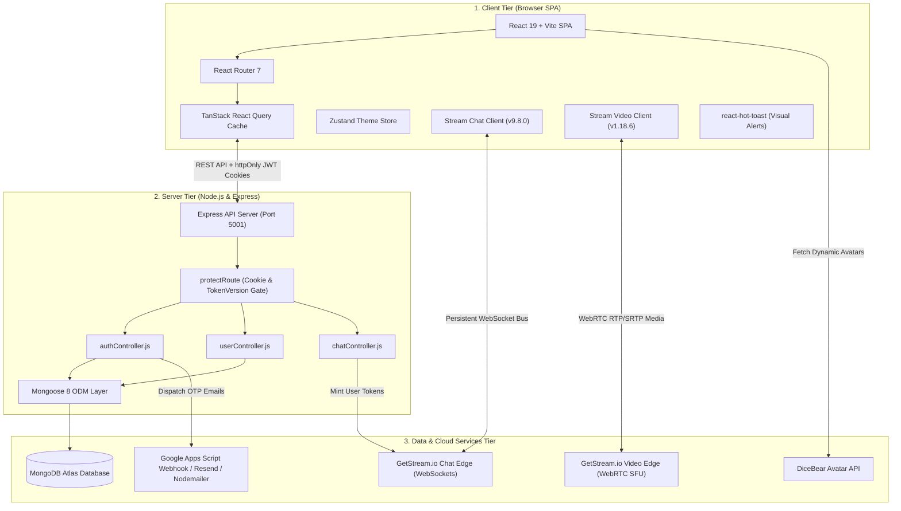
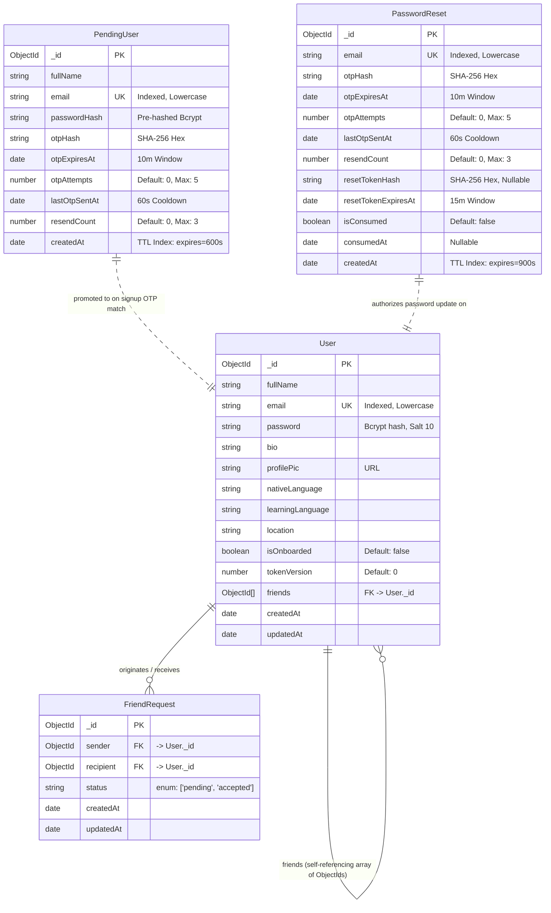
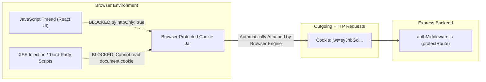
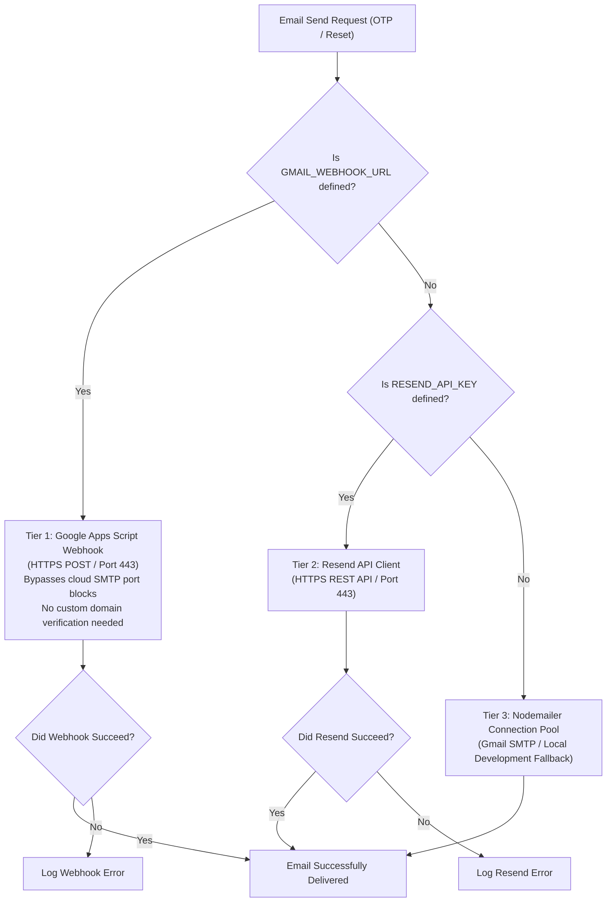
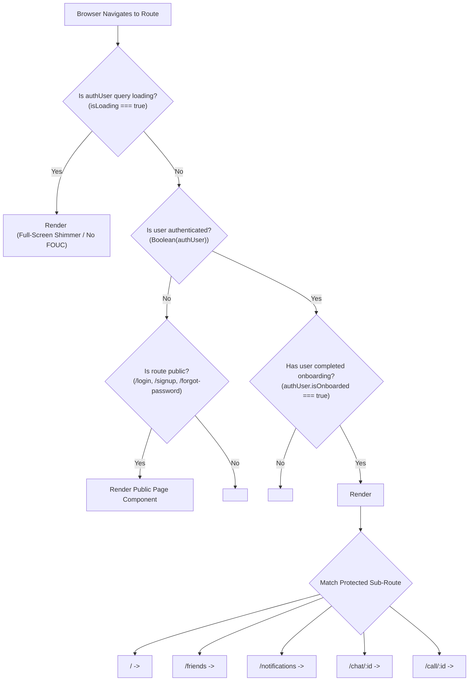
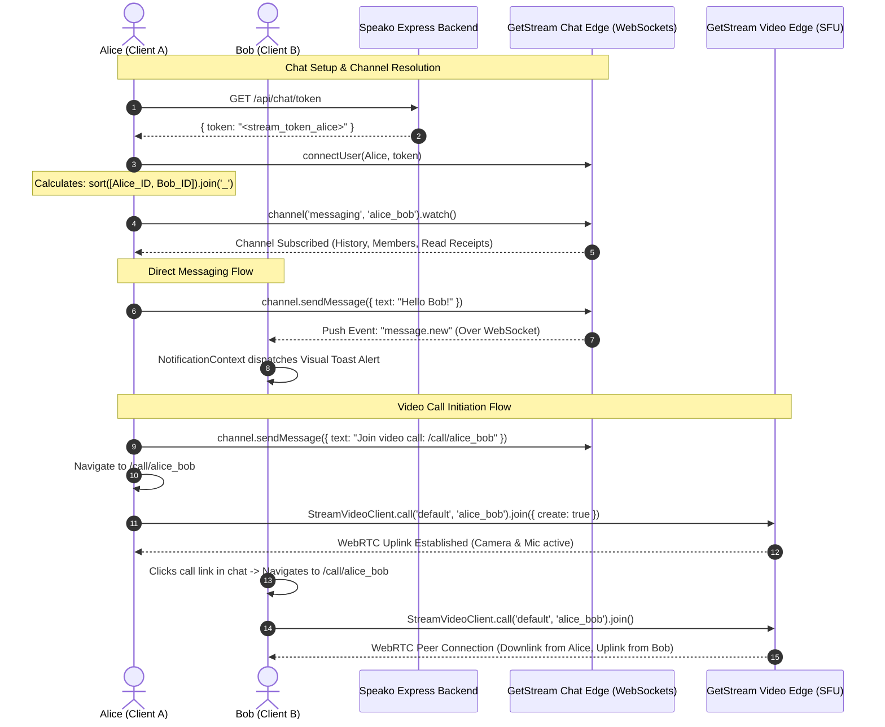
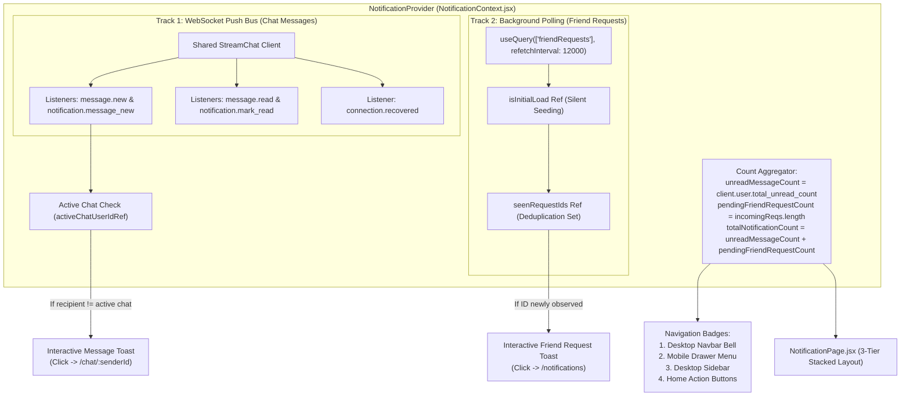

# Speako — Complete Architecture & Panel Presentation Master Guide

> **Project**: Speako (Language Exchange & Real-Time Communication Platform)  
> **Authors**: Speako Engineering Team  
> **Stack**: React 19, Vite 6, Tailwind CSS 3.4, DaisyUI 4, Node.js, Express.js 4, MongoDB Atlas, Mongoose 8, GetStream Chat & Video SDKs, Node Native Crypto, JWT, React Query 5, Zustand 5

---

## Table of Contents
1. [Architectural Overview & Executive Summary](#1-architectural-overview--executive-summary)
2. [Phase 1: High-Level Architecture & Technology Stack](#phase-1-high-level-architecture--technology-stack)
3. [Phase 2: Database Architecture & Data Models (MongoDB & Mongoose)](#phase-2-database-architecture--data-models)
4. [Phase 3: Backend Security, Cryptography & Failover Email Engine](#phase-3-backend-security-cryptography--failover-email-engine)
5. [Phase 4: Frontend State Architecture, UI & Routing (React 19 & Vite)](#phase-4-frontend-state-architecture-ui--routing)
6. [Phase 5: Real-Time Communication (Chat & WebRTC Video Calling)](#phase-5-real-time-communication)
7. [Phase 6: The Global Notification System & Advanced Real-Time Patterns](#phase-6-the-global-notification-system)
8. [Consolidated End-to-End System Walkthrough](#8-consolidated-end-to-end-system-walkthrough)
9. [Technical Glossary](#9-technical-glossary)
10. [Panel Defense Master Question & Answer Bank](#10-panel-defense-master-question--answer-bank)
11. [System Limitations, Known Trade-offs & Future Scaling Roadmap](#11-system-limitations-known-trade-offs--future-scaling-roadmap)

---

## 1. Architectural Overview & Executive Summary

Speako is an interactive language-learning community application designed to pair native speakers of different languages (e.g., a native English speaker learning Spanish paired with a native Spanish speaker learning English). 

The application provides:
- **Zero-Friction Discovery**: Language compatibility matching based on native and target learning languages.
- **Two-Step Identity Verification**: Mandatory 6-digit CSPRNG one-time passwords (OTP) for account signup and single-use password recovery sessions.
- **Sub-Second Direct Messaging**: Real-time bidirectional chat with read receipts, unread counters, and typing indicators via GetStream.
- **In-Browser WebRTC Video & Audio Rooms**: One-click peer-to-peer/SFU video calling without external tools.
- **Global Notification Hub**: Real-time visual toasts and dynamic navigation badges for incoming messages and friend requests, coupled with a 3-tier stacked notifications center.

### Core Architectural Philosophy
Speako is built on three core software engineering principles:
1. **The Separation of Concerns**: Clean isolation between persistent relational data (MongoDB), low-latency push messaging (GetStream WebSockets), media streaming (WebRTC SFU), and client UI state.
2. **Stateless Security with Defense in Depth**: Strict cookie-based session management (`httpOnly`, `sameSite: strict`, `secure`), constant-time cryptographic verification, and stateless session invalidation (`tokenVersion`).
3. **Engineering Parsimony (Minimal Server Overhead)**: Heavy transport loads (video routing and continuous WebSockets) are delegated to edge cloud providers. The Node.js Express server acts solely as a lightweight, authoritative identity gatekeeper.

---

# Phase 1: High-Level Architecture & Technology Stack



*Figure 1.1: Overall System Architecture.*  
*This diagram illustrates the three distinct tiers of Speako: the React client tier, the Node.js/Express server tier, and the external cloud tier. Notice how persistent user data flows strictly through the Express server to MongoDB, while real-time WebSocket messaging and WebRTC media bypass the application server entirely to communicate directly with GetStream's edge cloud.*

---

### 1.1 The Client-Server-Cloud Model

Speako divides computational responsibilities across three decoupled layers:

#### A. Client Tier (Browser Single-Page Application)
- **Role**: Presentation, routing, client-side caching, and user interactions.
- **Key Responsibilities**:
  - Renders UI using **React 19** and **DaisyUI / Tailwind CSS**.
  - Maintains client-side cache using **TanStack React Query**, eliminating redundant network calls.
  - Maintains direct real-time connections to GetStream for chat and media.
  - Never stores credentials or access tokens in insecure browser storage (`localStorage` or `sessionStorage`).

#### B. Server Tier (Express API Server)
- **Role**: Authoritative gatekeeper, business logic execution, data integrity, and token minting.
- **Key Responsibilities**:
  - Validates user input, password strength, and `@gmail.com` domain constraints.
  - Generates cryptographically secure random OTPs and authorization tokens.
  - Issues signed JSON Web Tokens (JWT) inside protected HTTP cookies.
  - Generates GetStream user tokens using the `STREAM_API_SECRET`.
  - Dispatches OTP emails across a 3-tier priority fallback pipeline.

#### C. Data & Cloud Services Tier
- **Role**: Offloading heavy storage, real-time networking, and media distribution.
- **MongoDB Atlas**: Stores persistent user profiles, friendship relations, and staging recovery records.
- **GetStream Chat Edge**: Maintains persistent TCP WebSockets for text messages, typing indicators, and read receipts.
- **GetStream Video Edge**: Acts as a Selective Forwarding Unit (SFU) for WebRTC audio/video packets, resolving NAT/firewall traversal via integrated STUN/TURN relays.
- **Google Apps Script / Resend**: Delivers emails over HTTPS (Port 443), bypassing cloud SMTP port restrictions.
- **DiceBear API**: Generates SVG and PNG avatar graphics.

---

### 1.2 Technology Stack Justification Table

| Category | Technology | Selected Version | Engineering Rationale & Trade-offs |
| :--- | :--- | :--- | :--- |
| **Frontend Framework** | **React** | `19.1.0` | Provides concurrent rendering, transitions, and seamless hook-based state management. Paired with Vite for sub-second development builds. |
| **Styling Engine** | **Tailwind CSS + DaisyUI** | `3.4.17` / `4.12.24` | Utility-first styling combined with DaisyUI semantic theme variables (`primary`, `base-100`, `base-200`). Switching themes modifies a single HTML attribute (`data-theme`) without altering component code. |
| **Server State Cache** | **TanStack React Query** | `5.80.7` | Eliminates Redux boilerplate for server data. Manages background refetching, mutation invalidation, request deduplication, and polling timers natively. |
| **Client UI State** | **Zustand** | `5.0.5` | Minimalist (<1KB) client state store used strictly for UI preferences (theme persistence in `localStorage`). |
| **Client Routing** | **React Router** | `7.6.2` | Declarative routing with nested layout persistence, route guards, and program navigation. |
| **Backend Runtime** | **Node.js + Express** | `4.21.0` | Event-driven, non-blocking I/O model ideal for concurrent API requests. Uses native ECMAScript Modules (`"type": "module"` in `package.json`). |
| **Database & ODM** | **MongoDB Atlas + Mongoose** | `8.13.2` | Document schema flexibility fits social graph modeling, nested arrays, and automatic TTL index expiration. |
| **Session Security** | **JSON Web Tokens (JWT)** | `9.0.2` | Stateless cryptographic session credentials signed with HMAC-SHA256 and transmitted exclusively via `httpOnly`, `sameSite: strict` cookies. |
| **Password Hashing** | **bcryptjs** | `3.0.2` | Adaptive one-way salted hashing with 10 rounds of work factor, defending against dictionary and rainbow table attacks. |
| **Real-Time Chat** | **GetStream Chat** | `9.8.0` / `13.2.1` | Enterprise WebSocket edge infrastructure. Eliminates need to scale custom Socket.io clusters or Redis pub/sub backends. |
| **Real-Time Video** | **Stream Video SDK** | `1.18.6` | WebRTC media relay (SFU) with automated TURN/STUN fallback, camera/microphone management, and speaker layouts. |
| **In-App Alerts** | **react-hot-toast** | `2.5.2` | Lightweight, non-intrusive toast notifications customized with DaisyUI theme styling. |

---

### 1.3 Repository Structure and Separation of Concerns

```
Speako/
├── backend/                       # Node.js + Express API Server
│   ├── package.json               # Backend dependencies (ES Modules: "type": "module")
│   └── src/
│       ├── server.js              # Application entry point, Express config, CORS, routes
│       ├── controllers/           # Request/response business logic
│       │   ├── authController.js  # Signup, OTP verify, login, logout, onboard, forgot password
│       │   ├── userController.js  # Friends, recommended learners, friend requests
│       │   └── chatController.js  # GetStream token provisioning endpoint
│       ├── middleware/
│       │   └── authMiddleware.js  # protectRoute: JWT verification & tokenVersion checking
│       ├── models/                # Mongoose database schemas
│       │   ├── User.js            # Persistent user profiles, friends list, tokenVersion
│       │   ├── PendingUser.js     # Unverified registration staging with 10-min TTL
│       │   ├── PasswordReset.js   # Recovery sessions & single-use tokens with 15-min TTL
│       │   └── FriendRequest.js   # Social graph states (pending / accepted)
│       ├── routes/                # Express router declarations
│       │   ├── authRoutes.js      # /api/auth/* endpoints
│       │   ├── userRoutes.js      # /api/users/* endpoints
│       │   └── chatRoutes.js      # /api/chat/* endpoints
│       └── lib/                   # External service clients & database connection
│           ├── db.js              # Mongoose connection to MongoDB Atlas
│           ├── mail.js            # 3-tier priority email engine (Webhook -> Resend -> Nodemailer)
│           └── stream.js          # GetStream server client (upsertUser, createToken)
│
└── frontend/                      # React 19 + Vite Single Page Application
    ├── package.json               # Frontend dependencies & build scripts
    ├── vite.config.js             # Vite bundler configuration
    ├── tailwind.config.js         # Tailwind CSS & DaisyUI theme definitions
    └── src/
        ├── main.jsx               # React DOM entry point, BrowserRouter, QueryClientProvider
        ├── App.jsx                # Route hierarchy, auth guards, Toaster provider
        ├── context/
        │   └── NotificationContext.jsx # Global Stream Chat singleton, badge math, toast dispatch
        ├── hooks/                 # Custom React hooks (useAuthUser, useLogin, useLogout)
        ├── lib/
        │   ├── axios.js           # Axios client configured with baseURL and withCredentials: true
        │   ├── api.js             # Typed API invocation functions matching backend endpoints
        │   └── utils.js           # Utility helpers (capitalization, date formatting)
        ├── store/
        │   └── useThemeStore.js   # Zustand store for DaisyUI theme selection & local persistence
        ├── components/            # Reusable UI components
        │   ├── Navbar.jsx         # Top header with dynamic badge overlays and mobile drawer
        │   ├── Sidebar.jsx        # Desktop side navigation bar with unread count badges
        │   ├── Layout.jsx         # Persistent frame rendering Navbar and Sidebar around pages
        │   ├── FriendCard.jsx     # Profile display card with language flags
        │   ├── CallButton.jsx     # In-chat video call trigger button
        │   ├── ChatLoader.jsx     # Shimmer skeleton loader for chat view
        │   └── PageLoader.jsx     # Full-screen spinner for initial auth evaluation
        └── pages/                 # Full-screen route views
            ├── HomePage.jsx       # Feed of friends and recommended language partners
            ├── LoginPage.jsx      # Sign in form with demo account quick-login buttons
            ├── SignupPage.jsx     # Multi-step OTP registration flow
            ├── ForgotPasswordPage.jsx # Multi-step secure password recovery flow
            ├── NotificationPage.jsx   # 3-tier stacked notifications center
            ├── ChatPage.jsx       # 1-on-1 direct messaging window with GetStream components
            ├── CallPage.jsx       # WebRTC video room with Stream Video SDK
            ├── FriendPage.jsx     # Dedicated friends list view
            └── OnboardingPage.jsx # First-time profile completion & avatar customization
```

---

# Phase 2: Database Architecture & Data Models

Speako's data tier uses **MongoDB** managed through the **Mongoose 8** Object Data Modeling (ODM) library.



*Figure 2.1: Entity Relationship Diagram.*  
*This diagram illustrates the 4 Mongoose models in Speako. Notice the self-referencing relationship in `User` where `friends` is an array of ObjectIds pointing back to `User._id`. Notice also that `PendingUser` and `PasswordReset` are completely isolated from each other and from `User`, ensuring unverified signups and password recovery sessions never share data or state.*

---

### 2.1 Deep-Dive: Model Specifications & Code Walkthroughs

#### Model 1: `User.js` — Persistent Profiles & Social Graph
- **File**: [`backend/src/models/User.js`](file:///Users/sauravkumar/.gemini/antigravity/scratch/Speako/backend/src/models/User.js)
- **Role**: Primary document representing registered, active user accounts.

```javascript
import mongoose from "mongoose";
import bcrypt from "bcryptjs";

const userSchema = new mongoose.Schema(
  {
    fullName: { type: String, required: true },
    email: { type: String, required: true, unique: true },
    password: { type: String, required: true, minlength: 6 },
    bio: { type: String, default: "" },
    profilePic: { type: String, default: "" },
    nativeLanguage: { type: String, default: "" },
    learningLanguage: { type: String, default: "" },
    location: { type: String, default: "" },
    isOnboarded: { type: Boolean, default: false },
    tokenVersion: { type: Number, default: 0 },
    friends: [
      {
        type: mongoose.Schema.Types.ObjectId,
        ref: "User",
      },
    ],
  },
  { timestamps: true }
);

// Mongoose Pre-Save Hook for Automatic Password Hashing
userSchema.pre("save", async function (next) {
  if (!this.isModified("password")) return next();

  try {
    const salt = await bcrypt.genSalt(10);
    this.password = await bcrypt.hash(this.password, salt);
    next();
  } catch (error) {
    next(error);
  }
});

// Custom Instance Method for Password Verification
userSchema.methods.matchPassword = async function (enteredPassword) {
  return await bcrypt.compare(enteredPassword, this.password);
};

const User = mongoose.model("User", userSchema);
export default User;
```

##### Field Analysis:
- `friends`: Array of `ObjectId` references to the `User` collection. Enables 2-way friendship lookups without a relational join table.
- `isOnboarded`: Boolean flag. Used by frontend route guards to force newly registered users to complete their profile (name, bio, language pairing, avatar) before accessing the platform.
- `tokenVersion`: Monotonically increasing integer. Used by authentication middleware to invalidate active user sessions across all devices when a password is reset.

---

#### Model 2: `PendingUser.js` — Unverified Signup Staging
- **File**: [`backend/src/models/PendingUser.js`](file:///Users/sauravkumar/.gemini/antigravity/scratch/Speako/backend/src/models/PendingUser.js)
- **Role**: Temporary staging document for user signups awaiting 6-digit email OTP verification.

```javascript
import mongoose from "mongoose";

const pendingUserSchema = new mongoose.Schema(
  {
    fullName: { type: String, required: true, trim: true },
    email: { type: String, required: true, unique: true, lowercase: true, trim: true },
    passwordHash: { type: String, required: true },
    otpHash: { type: String, required: true },
    otpExpiresAt: { type: Date, required: true },
    otpAttempts: { type: Number, default: 0, min: 0 },
    lastOtpSentAt: { type: Date, default: Date.now },
    resendCount: { type: Number, default: 0, min: 0 },
    createdAt: {
      type: Date,
      default: Date.now,
      expires: 600, // 600 seconds = 10 minutes (MongoDB TTL Index)
    },
  },
  { timestamps: false }
);

const PendingUser = mongoose.model("PendingUser", pendingUserSchema);
export default PendingUser;
```

##### Architectural Design:
- **Zero Database Bloat**: MongoDB's background Time-To-Live (TTL) thread automatically purges documents 10 minutes after `createdAt`. If a user abandons registration, no orphaned user records pollute the primary `User` collection.
- **Brute-Force Counter**: `otpAttempts` tracks incorrect code submissions directly on the staging document. Once attempts reach 5, the document is destroyed.
- **Pre-Hashed Storage**: The password is pre-hashed with bcrypt before entering `PendingUser`. Raw passwords never exist in database memory.

---

#### Model 3: `PasswordReset.js` — Single-Use Recovery Sessions
- **File**: [`backend/src/models/PasswordReset.js`](file:///Users/sauravkumar/.gemini/antigravity/scratch/Speako/backend/src/models/PasswordReset.js)
- **Role**: Manages password recovery state machines with single-use token authorization.

```javascript
import mongoose from "mongoose";

const passwordResetSchema = new mongoose.Schema(
  {
    email: { type: String, required: true, unique: true, lowercase: true, trim: true },
    otpHash: { type: String, required: true },
    otpExpiresAt: { type: Date, required: true },
    otpAttempts: { type: Number, default: 0, min: 0 },
    lastOtpSentAt: { type: Date, default: Date.now },
    resendCount: { type: Number, default: 0, min: 0 },
    resetTokenHash: { type: String, default: null },
    resetTokenExpiresAt: { type: Date, default: null },
    isConsumed: { type: Boolean, default: false },
    consumedAt: { type: Date, default: null },
    createdAt: {
      type: Date,
      default: Date.now,
      expires: 900, // 900 seconds = 15 minutes (MongoDB TTL Index)
    },
  },
  { timestamps: false }
);

const PasswordReset = mongoose.model("PasswordReset", passwordResetSchema);
export default PasswordReset;
```

##### Architectural Design:
- **Separation from Signup**: An OTP generated for account registration can never be accepted for password recovery because they live in physically distinct collections.
- **Two-Phase Authorization**: Phase 1 validates the 6-digit OTP. Upon success, Phase 2 generates a 32-byte cryptographic token stored in `resetTokenHash`. The password update endpoint requires this token, guaranteeing that only the verified email owner can change the password.
- **Single-Use Enforcement**: `isConsumed: true` prevents replay attacks.

---

#### Model 4: `FriendRequest.js` — Social Graph Connection States
- **File**: [`backend/src/models/FriendRequest.js`](file:///Users/sauravkumar/.gemini/antigravity/scratch/Speako/backend/src/models/FriendRequest.js)
- **Role**: Tracks asynchronous connection invitations between language learners.

```javascript
import mongoose from "mongoose";

const friendRequestSchema = new mongoose.Schema(
  {
    sender: { type: mongoose.Schema.Types.ObjectId, ref: "User", required: true },
    recipient: { type: mongoose.Schema.Types.ObjectId, ref: "User", required: true },
    status: {
      type: String,
      enum: ["pending", "accepted"],
      default: "pending",
    },
  },
  { timestamps: true }
);

const FriendRequest = mongoose.model("FriendRequest", friendRequestSchema);
export default FriendRequest;
```

---

### 2.2 Critical Database Patterns & Implementation Logic

#### Pattern A: The Double-Hashing Trap and How Speako Prevents It
- **What it is**: In Mongoose, if a model defines a `pre("save")` hook to hash passwords with bcrypt, saving an *already-hashed* password will cause Mongoose to salt and hash the bcrypt hash a second time. This corrupts the password, permanently breaking logins.
- **Why Speako needs a solution**: During registration, the user's password is pre-hashed and stored in `PendingUser.passwordHash`. When the user verifies their OTP, we must move that record into `User`. If we called `new User({ password: pendingUser.passwordHash }).save()`, Mongoose would detect `password` as modified and run bcrypt again.
- **How Speako solves it**: In [`authController.js#L184-L191`](file:///Users/sauravkumar/.gemini/antigravity/scratch/Speako/backend/src/controllers/authController.js#L184-L191), Speako bypasses Mongoose document middleware by inserting the document directly through the underlying MongoDB native collection driver:
  ```javascript
  // Prepare User document object
  const userDoc = userInstance.toObject();
  const now = new Date();
  userDoc.createdAt = now;
  userDoc.updatedAt = now;

  // DIRECT INSERTION: Bypasses Mongoose pre("save") re-hashing completely!
  await User.collection.insertOne(userDoc);
  ```
- **Password Reset Handling**: Conversely, in [`resetPassword`](file:///Users/sauravkumar/.gemini/antigravity/scratch/Speako/backend/src/controllers/authController.js#L614-L617), the user provides a *plaintext* new password. Here, we deliberately assign the plaintext string and call `await user.save()`, allowing the `pre("save")` hook to generate a fresh salt and hash the password correctly.

---

#### Pattern B: Atomic Concurrency Protection via `findOneAndUpdate`
- **What it is**: Ensuring that concurrent requests submitted at the exact same millisecond cannot redeem the same reset token more than once.
- **Why Speako needs it**: If an attacker fires two parallel HTTP requests with a captured reset token, a non-atomic `findOne` followed by `save()` creates a race condition where both threads read `isConsumed === false` before either saves `true`. Both requests would succeed, potentially allowing unauthorized password changes.
- **How Speako solves it**: In [`authController.js#L593-L604`](file:///Users/sauravkumar/.gemini/antigravity/scratch/Speako/backend/src/controllers/authController.js#L593-L604), Speako executes an atomic write operation at the database engine level:
  ```javascript
  const resetSession = await PasswordReset.findOneAndUpdate(
    {
      resetTokenHash,
      isConsumed: false,
      resetTokenExpiresAt: { $gt: new Date() },
    },
    {
      isConsumed: true,
      consumedAt: new Date(),
    },
    { new: false } // Returns pre-update document
  );

  if (!resetSession) {
    return res.status(400).json({
      message: "Invalid or expired password reset token. Please request a new code.",
    });
  }
  ```
- **Concurrency Guarantee**: MongoDB evaluates the query filter and write lock atomically. The first request matches `{ isConsumed: false }` and flips it to `true`. The second request finds 0 matching documents, receives `null`, and is rejected immediately.

---

#### Pattern C: Atomic Social Graph Mutations with `$addToSet` and `$nin`
- **What it is**: Safe manipulation of nested array fields in MongoDB documents without reading the entire document into server memory.
- **Accepting Friend Requests** ([`userController.js#L98-L104`](file:///Users/sauravkumar/.gemini/antigravity/scratch/Speako/backend/src/controllers/userController.js#L98-L104)):
  ```javascript
  // $addToSet guarantees duplicate IDs are never inserted into the friends array
  await User.findByIdAndUpdate(friendRequest.sender, {
    $addToSet: { friends: friendRequest.recipient },
  });
  await User.findByIdAndUpdate(friendRequest.recipient, {
    $addToSet: { friends: friendRequest.sender },
  });
  ```
  `$addToSet` ensures idempotency: even if network lag causes double-clicks on "Accept", the friend ID is added exactly once.
- **Partner Recommendation Filtering** ([`userController.js#L11-L17`](file:///Users/sauravkumar/.gemini/antigravity/scratch/Speako/backend/src/controllers/userController.js#L11-L17)):
  ```javascript
  const recommendedUser = await User.find({
    $and: [
      { _id: { $ne: currentUserId } },           // Exclude self ($ne = not equal)
      { _id: { $nin: currentUser.friends } },    // Exclude existing friends ($nin = not in)
      { isOnboarded: true },                     // Exclude incomplete profiles
    ],
  });
  ```

---

#### Pattern D: Dual-Layer Expiration (MongoDB TTL vs. Application Checks)
- **What it is**: Enforcing expiration boundaries both in the database storage engine and in application execution logic.
- **Why both are required**: MongoDB's background TTL thread runs **once every 60 seconds**. If a token has a 10-minute validity and expires at 12:10:00, MongoDB's background thread might not sweep and delete the document until 12:10:45.
- **The Defense**:
  1. **MongoDB TTL (`expires: 600`)**: Handles automated storage cleanup and database garbage collection.
  2. **Application Logic (`if (new Date() > record.otpExpiresAt)`)**: Enforces sub-millisecond precision on every incoming request. Even if the document still exists in MongoDB storage, the application layer rejects it instantly.

---

# Phase 3: Backend Security, Cryptography & Failover Email Engine

```mermaid
sequenceDiagram
    autonumber
    actor User as User Browser
    participant API as Express API (/api/auth)
    participant Crypto as Node.js Crypto / Bcrypt
    participant Mail as Email Engine (mail.js)
    participant Mongo as MongoDB Atlas

    Note over User,Mongo: Password Recovery & Enumeration Protection Flow
    User->>API: POST /forgot-password { email }
    API->>API: Validate email format & @gmail.com domain
    API->>Mongo: User.findOne({ email })
    
    alt User Does NOT Exist
        API->>Crypto: crypto.randomBytes(16) + SHA-256 (Dummy Hash Work)
        API-->>User: 200 OK: "If account exists, verification code sent" (NO LEAK)
    else User Exists
        API->>Mongo: Check PasswordReset cooldown (60s) & resends (<3)
        API->>Crypto: crypto.randomInt(100000, 1000000) -> 6-digit OTP
        API->>Crypto: SHA-256 hash of OTP
        API->>Mongo: Upsert PasswordReset (15m TTL, otpHash, isConsumed=false)
        API->>Mail: sendPasswordResetEmail(email, otp)
        API-->>User: 200 OK: "If account exists, verification code sent"
    end

    Note over User,Mongo: OTP Verification Phase
    User->>API: POST /verify-reset-otp { email, otp }
    API->>Mongo: PasswordReset.findOne({ email })
    API->>API: Check: !isConsumed && otpAttempts < 5 && now < otpExpiresAt
    API->>Crypto: crypto.timingSafeEqual(submittedHash, record.otpHash)
    API->>Crypto: crypto.randomBytes(32).toString('hex') -> resetToken (64 chars)
    API->>Crypto: SHA-256 hash of resetToken
    API->>Mongo: Update record: resetTokenHash, otpHash='used'
    API-->>User: 200 OK: { success: true, resetToken }

    Note over User,Mongo: Password Reset & Session Invalidation Phase
    User->>API: POST /reset-password { resetToken, newPassword }
    API->>Crypto: SHA-256 hash of resetToken
    API->>Mongo: findOneAndUpdate({ resetTokenHash, isConsumed: false }, { isConsumed: true })
    API->>Mongo: User.findOne({ email })
    API->>API: user.password = newPassword (Pre-save hashes plaintext)
    API->>API: user.tokenVersion += 1 (INVALIDATES ALL SESSIONS)
    API->>Mongo: user.save()
    API->>Mongo: PasswordReset.deleteOne({ email })
    API-->>User: Set-Cookie: Clear jwt; 200 OK: "Password reset successfully"
```

*Figure 3.1: Password Recovery and Session Invalidation Sequence.*  
*This sequence diagram demonstrates Speako's secure password recovery flow. Notice the dummy cryptographic calculation when a user is not found to prevent timing-based email enumeration, the constant-time OTP verification, the atomic consumption of the resetToken, and the increment of `tokenVersion` to revoke all active sessions across devices.*

---

### 3.1 Cryptographic Implementations

#### A. Cryptographically Secure Pseudo-Random Numbers (CSPRNG)
- **Problem**: `Math.random()` uses pseudo-random algorithms (e.g., xorshift128+) that are deterministic. An attacker who captures several consecutive OTPs can calculate the internal seed and predict future OTPs.
- **Implementation** ([`authController.js#L52`](file:///Users/sauravkumar/.gemini/antigravity/scratch/Speako/backend/src/controllers/authController.js#L52)):
  ```javascript
  const otp = crypto.randomInt(100000, 1000000).toString();
  ```
- **Under the Hood**: Node's `crypto.randomInt` draws entropy directly from the OS kernel entropy pool (`/dev/urandom` on Linux/macOS, `BCryptGenRandom` on Windows). It is cryptographically non-deterministic.

---

#### B. Constant-Time Hash Comparison (`crypto.timingSafeEqual`)
- **Problem**: Standard equality operators (`===` or `==`) use early-exit optimization, terminating as soon as the first non-matching character is found. An attacker measuring request latency over a large sample can deduce the OTP character by character (a side-channel timing attack).
- **Implementation** ([`authController.js#L135-L140`](file:///Users/sauravkumar/.gemini/antigravity/scratch/Speako/backend/src/controllers/authController.js#L135-L140)):
  ```javascript
  const submittedOtpHash = crypto.createHash("sha256").update(cleanOtp).digest("hex");
  const isMatch = crypto.timingSafeEqual(
    Buffer.from(submittedOtpHash, "hex"),
    Buffer.from(pendingUser.otpHash, "hex")
  );
  ```
- **Under the Hood**: `timingSafeEqual` executes in strictly constant CPU cycles regardless of where or whether the byte values differ.

---

#### C. Account Enumeration & Timing Side-Channel Defense
- **Problem**: If an API returns `"User not found"` for invalid emails and `"Code sent"` for valid emails, attackers can harvest registered users. Even if the server returns a generic message, doing password lookups or hashing *only* when the email exists leaks account existence through response latency.
- **Implementation** ([`authController.js#L423-L432`](file:///Users/sauravkumar/.gemini/antigravity/scratch/Speako/backend/src/controllers/authController.js#L423-L432)):
  ```javascript
  const user = await User.findOne({ email: normalizedEmail });
  if (!user) {
    // Perform dummy cryptographic work to normalize execution latency
    const dummySalt = crypto.randomBytes(16).toString("hex");
    crypto.createHash("sha256").update(dummySalt).digest("hex");

    return res.status(200).json({
      success: true,
      message: "If an account with that email exists, a verification code has been sent.",
      email: normalizedEmail,
    });
  }
  ```

---

### 3.2 Session Security & Cookie Hardening

Speako strictly forbids storing authentication tokens in browser `localStorage` or `sessionStorage`.



*Figure 3.2: Cookie Hardening Architecture.*  
*This diagram illustrates why Speako uses `httpOnly` cookies. Malicious scripts and third-party packages in the JavaScript context cannot read or exfiltrate the JWT. The browser engine securely attaches the cookie to outgoing requests over HTTPS.*

#### Cookie Configuration Profile ([`authController.js#L214-L219`](file:///Users/sauravkumar/.gemini/antigravity/scratch/Speako/backend/src/controllers/authController.js#L214-L219)):
```javascript
res.cookie("jwt", token, {
  maxAge: 7 * 24 * 60 * 60 * 1000,              // 7 days expiration
  httpOnly: true,                               // Completely hidden from document.cookie (XSS immune)
  sameSite: "strict",                           // Blocked on cross-origin requests (CSRF immune)
  secure: process.env.NODE_ENV === "production", // Transmitted exclusively over encrypted HTTPS
});
```

#### Stateless Session Invalidation via `tokenVersion`
In [`authMiddleware.js#L25-L35`](file:///Users/sauravkumar/.gemini/antigravity/scratch/Speako/backend/src/middleware/authMiddleware.js#L25-L35):
```javascript
// Backward-compatible tokenVersion check for instant session revocation
const userTokenVersion = user.tokenVersion || 0;

if (decoded.tokenVersion === undefined) {
  // Legacy token issued before tokenVersion deployment
  if (userTokenVersion > 0) {
    res.clearCookie("jwt");
    return res.status(401).json({ message: "Unauthorized - Session expired. Please log in again." });
  }
} else if (decoded.tokenVersion !== userTokenVersion) {
  // Token version mismatch: Password was reset on another device!
  res.clearCookie("jwt");
  return res.status(401).json({ message: "Unauthorized - Session expired. Please log in again." });
}
```

---

### 3.3 The 3-Tier Failover Email Engine (`mail.js`)

- **File**: [`backend/src/lib/mail.js`](file:///Users/sauravkumar/.gemini/antigravity/scratch/Speako/backend/src/lib/mail.js)
- **The Problem**: Cloud hosting platforms (such as Render, AWS, Heroku, and DigitalOcean) block outbound SMTP ports (`25`, `465`, `587`) by default to prevent spam. Standard Nodemailer connections hang and time out in production.
- **The Architecture**: Speako implements a 3-tier priority delivery engine:



*Figure 3.3: 3-Tier Failover Email Pipeline.*  
*This diagram illustrates Speako's email delivery priority. Because Tier 1 and Tier 2 use standard HTTPS on Port 443, they are never blocked by cloud firewalls, ensuring reliable OTP delivery in production.*

---

# Phase 4: Frontend State Architecture, UI & Routing

Speako’s client-side architecture runs on **React 19** and **Vite 6**.



*Figure 4.1: React Router 7 Hierarchical Route Guard Pipeline.*  
*This flowchart demonstrates the three-tier gating hierarchy in Speako: Tier 1 guards against Flash of Unauthenticated Content (FOUC), Tier 2 checks authentication, and Tier 3 forces incomplete profiles into the onboarding workflow.*

---

### 4.1 Server State vs. Client State Architecture

Speako separates asynchronous server data from synchronous local UI preferences:

| Aspect | Server State (`@tanstack/react-query`) | Client State (`zustand`) |
| :--- | :--- | :--- |
| **Tool** | TanStack React Query v5 | Zustand v5 |
| **Examples in Speako** | `authUser`, `friends`, `recommendedUsers`, `friendRequests`, `streamToken` | Theme preference (`speako-theme`: `'forest'`, `'coffee'`, `'dark'`) |
| **Ownership** | Remote backend database | Local browser `localStorage` |
| **Synchronization** | Network fetch with declarative cache invalidation | Synchronous state mutation |
| **Cache Management** | Automatic garbage collection, polling timers, background revalidation | Persists across browser sessions |

#### Cache Invalidation on Mutation:
When a user accepts a friend request in [`NotificationPage.jsx`](file:///Users/sauravkumar/.gemini/antigravity/scratch/Speako/frontend/src/pages/NotificationPage.jsx#L26-L32):
```javascript
const { mutate: acceptRequestMutation } = useMutation({
  mutationFn: acceptFriendRequest,
  onSuccess: () => {
    // Invalidate cached query keys to trigger automatic background refetches
    queryClient.invalidateQueries({ queryKey: ["friendRequests"] });
    queryClient.invalidateQueries({ queryKey: ["friends"] });
  },
});
```

---

### 4.2 Dynamic Theming with DaisyUI & Tailwind

- **Store**: [`frontend/src/store/useThemeStore.js`](file:///Users/sauravkumar/.gemini/antigravity/scratch/Speako/frontend/src/store/useThemeStore.js)
```javascript
import { create } from "zustand";

export const useThemeStore = create((set) => ({
  theme: localStorage.getItem("speako-theme") || "coffee",
  setTheme: (theme) => {
    localStorage.setItem("speako-theme", theme);
    set({ theme });
  },
}));
```
- **Application Injection**: In [`App.jsx#L29`](file:///Users/sauravkumar/.gemini/antigravity/scratch/Speako/frontend/src/App.jsx#L29):
  ```jsx
  <div className="min-h-screen" data-theme={theme}>
  ```
  DaisyUI dynamically restyles all background colors, text contrast, borders, and buttons based on semantic CSS variables without changing component classes.

---

### 4.3 Multi-Step UI State Machines & UX Safeguards

In both [`SignupPage.jsx`](file:///Users/sauravkumar/.gemini/antigravity/scratch/Speako/frontend/src/pages/SignupPage.jsx) and [`ForgotPasswordPage.jsx`](file:///Users/sauravkumar/.gemini/antigravity/scratch/Speako/frontend/src/pages/ForgotPasswordPage.jsx):
1. **Monospaced Auto-Filtered OTP Inputs**:
   ```jsx
   <input
     type="text"
     maxLength={6}
     inputMode="numeric"
     autoComplete="one-time-code"
     placeholder="••••••"
     className="input input-bordered w-full text-center text-3xl font-mono tracking-widest font-bold focus:border-primary"
     value={otp}
     onChange={(e) => setOtp(e.target.value.replace(/\D/g, ""))}
     autoFocus
   />
   ```
2. **Self-Cleaning Cooldown Timer**:
   ```javascript
   useEffect(() => {
     if (step !== 2 || countdown <= 0) return;
     const timer = setInterval(() => {
       setCountdown((prev) => (prev > 0 ? prev - 1 : 0));
     }, 1000);
     return () => clearInterval(timer); // Prevents memory leaks on component unmount
   }, [step, countdown]);
   ```
3. **Session Recovery**:
   In `SignupPage.jsx`, `sessionStorage.getItem("speako_signup_step")` restores the OTP verification screen if the user accidentally refreshes the browser, preventing them from having to re-enter their registration details.

---

# Phase 5: Real-Time Communication (Chat & WebRTC Video)



*Figure 5.1: Real-Time Messaging and WebRTC Video Sequence.*  
*This sequence diagram shows how direct messaging and WebRTC video work in Speako. Notice the deterministic channel ID resolution (`alice_bob`), how messages push over WebSockets to trigger notification toasts, and how video calls route through Stream's Selective Forwarding Unit (SFU).*

---

### 5.1 Direct Messaging & Deterministic Channel IDs

- **The Problem**: In 1-on-1 direct messaging, two users must always enter the same conversation room regardless of who starts the chat. If User A initiates chat with User B, and User B later initiates chat with User A, random UUIDs would create duplicate, split conversations.
- **The Solution** ([`ChatPage.jsx#L34`](file:///Users/sauravkumar/.gemini/antigravity/scratch/Speako/frontend/src/pages/ChatPage.jsx#L34)):
  ```javascript
  const channelId = [authUser._id, targetUserId].sort().join("_");

  const currChannel = chatClient.channel("messaging", channelId, {
    members: [authUser._id, targetUserId],
  });

  await currChannel.watch();
  await currChannel.markRead(); // Immediately clears unread count for this room
  ```
- **Mathematical Invariance**:
  $$\text{sort}([A, B]) = \text{sort}([B, A]) \implies \text{channelId is identical}$$
  No database lookups or conversation mapping tables are needed to resolve the room ID.

---

### 5.2 In-Chat Video Calling with Stream Video SDK

- **SDK Package**: `@stream-io/video-react-sdk` v1.18.6
- **Architecture**: In [`frontend/src/pages/CallPage.jsx`](file:///Users/sauravkumar/.gemini/antigravity/scratch/Speako/frontend/src/pages/CallPage.jsx):
  ```javascript
  const videoClient = new StreamVideoClient({
    apiKey: STREAM_API_KEY,
    user: {
      id: authUser._id,
      name: authUser.fullName,
      image: authUser.profilePic || "/p7.png",
    },
    token: tokenData.token,
  });

  const callInstance = videoClient.call("default", CallId);
  await callInstance.join({ create: true });
  ```
- **UI Components & Layout**:
  ```jsx
  <StreamVideo client={client}>
    <StreamCall call={call}>
      <StreamTheme>
        <SpeakerLayout />   {/* Dynamic layout focusing on active speaker */}
        <CallControls />    {/* Mic, Camera, Screen share, and End call controls */}
      </StreamTheme>
    </StreamCall>
  </StreamVideo>
  ```
- **Call Disconnection Handling**:
  ```javascript
  const callingState = useCallCallingState();
  if (callingState === CallingState.LEFT) return navigate("/");
  ```
  When either user hangs up, the SDK cleanly releases camera/mic hardware locks and returns the user to the home screen.

---

# Phase 6: The Global Notification System



*Figure 6.1: Global Notification Event Pipeline.*  
*This diagram illustrates Speako's hybrid notification system. Track 1 handles instant chat messages over GetStream WebSockets. Track 2 polls friend requests every 12 seconds with silent initial seeding. The count aggregator merges both counts to drive badges and the 3-tier stacked notifications page.*

---

### 6.1 Architectural Highlights of `NotificationContext.jsx`

#### A. Shared Stream Singleton (Zero Duplicate Connections)
- [`NotificationContext.jsx`](file:///Users/sauravkumar/.gemini/antigravity/scratch/Speako/frontend/src/context/NotificationContext.jsx) mounts at the authenticated app root.
- It connects `StreamChat.getInstance(STREAM_API_KEY)` once on login.
- [`ChatPage.jsx`](file:///Users/sauravkumar/.gemini/antigravity/scratch/Speako/frontend/src/pages/ChatPage.jsx#L15) consumes the already-connected client from `useNotifications()`. Opening a conversation does not execute redundant `connectUser()` calls or open duplicate WebSockets.
- On logout, `client.disconnectUser()` is called once, destroying event listeners cleanly.

#### B. Active Conversation Toast Suppression
- In `NotificationContext.jsx`:
  ```javascript
  const [activeChatUserId, setActiveChatUserId] = useState(null);
  const activeChatUserIdRef = useRef(activeChatUserId);
  activeChatUserIdRef.current = activeChatUserId;
  ```
- When `ChatPage` mounts for `targetUserId`, it sets `setActiveChatUserId(targetUserId)`.
- When an incoming message arrives, the event callback checks:
  ```javascript
  if (activeChatUserIdRef.current === senderId) {
    return; // SUPPRESS TOAST: User is actively looking at this conversation!
  }
  ```

#### C. Silent Initial Seeding & Deduplication
- Prevents "Toast Storms" on page refresh:
  ```javascript
  const isInitialLoad = useRef(true);
  const seenRequestIds = useRef(new Set());

  useEffect(() => {
    if (!friendRequests?.incomingReqs) return;
    const incomingIds = new Set(friendRequests.incomingReqs.map(r => r._id));

    // First load: silently seed known IDs without firing toasts
    if (isInitialLoad.current) {
      seenRequestIds.current = incomingIds;
      isInitialLoad.current = false;
      return;
    }

    // Subsequent intervals: toast ONLY newly observed request IDs
    friendRequests.incomingReqs.forEach((req) => {
      if (!seenRequestIds.current.has(req._id)) {
        seenRequestIds.current.add(req._id);
        dispatchFriendRequestToast(req);
      }
    });

    seenRequestIds.current = incomingIds;
  }, [friendRequests]);
  ```

---

### 6.2 Badge Distribution & Compact Formatting

```javascript
const badgeText = totalNotificationCount > 99 ? "99+" : totalNotificationCount;
```

1. **Desktop Navbar Bell Icon** ([`Navbar.jsx#L118-L127`](file:///Users/sauravkumar/.gemini/antigravity/scratch/Speako/frontend/src/components/Navbar.jsx#L118-L127)):
   ```jsx
   <button className="btn btn-ghost btn-circle relative">
     <BellIcon className="h-6 w-6 text-base-content opacity-70" />
     {totalNotificationCount > 0 && (
       <span className="badge badge-primary badge-xs absolute top-1.5 right-1.5 font-bold min-w-4 h-4 px-1 flex items-center justify-center animate-pulse">
         {badgeText}
       </span>
     )}
   </button>
   ```
2. **Mobile Drawer Menu** ([`Navbar.jsx#L223-L235`](file:///Users/sauravkumar/.gemini/antigravity/scratch/Speako/frontend/src/components/Navbar.jsx#L223-L235)): Shows inline badge counter next to "Notifications".
3. **Desktop Sidebar** ([`Sidebar.jsx#L42-L55`](file:///Users/sauravkumar/.gemini/antigravity/scratch/Speako/frontend/src/components/Sidebar.jsx#L42-L55)): Displays inline badge counter adjacent to the navigation link.
4. **Home Page & Friends Page**: Displays `pendingFriendRequestCount` directly on the "Friend Requests" action button.

---

### 6.3 The 3-Tier Stacked Notifications Page

In [`NotificationPage.jsx`](file:///Users/sauravkumar/.gemini/antigravity/scratch/Speako/frontend/src/pages/NotificationPage.jsx), notifications are presented in three stacked sections:

1. **Section 1: Friend Requests**:
   - Lists pending incoming requests with sender avatar, name, native/learning language badges, and an "Accept" button.
2. **Section 2: New Connections**:
   - Lists accepted requests where the other user confirmed friendship.
3. **Section 3: Unread Messages**:
   - Queries unread channels from Stream (`channel.countUnread() > 0`).
   - Displays friend's avatar, name, unread count badge, latest message snippet, timestamp, and an interactive `"Reply"` button navigating directly to `/chat/:friendId`.
- **Unified Empty State**: Renders `<NoNotificationsFound />` only when all three sections are empty.

---

# 8. Consolidated End-to-End System Walkthrough

### Scenario: Complete User Journey
1. **Signup**: User visits `/signup`, enters `alex@gmail.com`. Password hashed once (10 rounds bcrypt). 6-digit CSPRNG code sent via Google Apps Script Webhook. Staged in `PendingUser`.
2. **Verification**: Alex enters code. Constant-time comparison matches. `User.collection.insertOne` bypasses Mongoose pre-save re-hashing. GetStream user created. Signed JWT issued in `httpOnly` cookie.
3. **Onboarding**: Gated by `isOnboarded: false`. Alex selects English (native), Japanese (learning), and generates a DiceBear avatar. Profile updated.
4. **Partner Discovery**: Alex visits `/`. Speako queries `User.find({ _id: { $ne: alexId, $nin: alexFriends } })`. Recommends Kenji. Alex clicks "Send Friend Request".
5. **Real-Time Notification**: Kenji is on Home. React Query's 12-second poll detects Alex's request. Kenji sees an interactive toast: *"Friend Request from Alex"*. Navbar bell shows `1`.
6. **Chat & Video**: Kenji accepts. Alex opens `/chat/kenjiId`. Deterministic room `alex_kenji` resolves. Alex sends a text (Kenji gets toast). Alex clicks video button; both enter `/call/alex_kenji` via WebRTC SFU.
7. **Password Recovery & Revocation**: Next week, Alex forgets password. Enters email on `/forgot-password`. Verifies OTP. Single-use `resetToken` atomically consumed. `tokenVersion` increments from 0 to 1. All older browser sessions are instantly revoked.

---

# 9. Technical Glossary

- **CSPRNG (Cryptographically Secure Pseudo-Random Number Generator)**: A random number generator drawing entropy from the OS kernel, producing outputs that are mathematically impossible to predict.
- **Timing Attack**: A side-channel attack where an adversary measures nanosecond variations in response times (e.g., standard `===` string comparisons) to deduce sensitive data.
- **TTL (Time-To-Live) Index**: A specialized MongoDB index on date fields that causes MongoDB's background thread to automatically delete documents after a specified number of seconds.
- **Idempotency**: An API property where making the same request multiple times produces the exact same outcome as making it once (e.g., `$addToSet` in MongoDB).
- **SFU (Selective Forwarding Unit)**: A WebRTC server architecture where participants send their media stream once to a central edge router, which forwards it to other participants without transcoding.
- **FOUC (Flash of Unauthenticated Content)**: A rendering glitch where a protected application flashes a login screen for a fraction of a second while verifying session cookies.
- **Double-Hashing**: A Mongoose defect where pre-save hashing hooks re-hash an already-hashed password string.

---

# 10. Panel Defense Master Question & Answer Bank

### Category 1: Database Architecture & Data Modeling
#### Q1.1: "Why create a separate `PendingUser` collection instead of adding `isVerified: false` to the `User` collection?"
* **Direct Answer**: *"To protect unique email indexes, keep working-set memory small, and leverage native MongoDB TTL indexes for automated garbage collection."*
* **Deep Defense**: An `isVerified: false` field pollutes the unique index on `email`, blocking abandoned signups from re-registering unless complex compound partial indexes are maintained. Furthermore, unverified accounts pollute daily login queries. `PendingUser` isolates staging data, allowing a native TTL index (`expires: 600`) to purge abandoned registrations after 10 minutes without custom cron jobs.

#### Q1.2: "How does the `friends` array scale, and what is its theoretical limit?"
* **Direct Answer**: *"It is an embedded array optimized for $O(1)$ reads for typical user sizes, bounded by MongoDB's 16MB document limit."*
* **Deep Defense**: For language exchange apps where users have tens or hundreds of partners, embedding `friends: [{ type: ObjectId, ref: 'User' }]` avoids expensive `$lookup` joins. If Speako scaled to an enterprise social network with 100,000+ connections per user, we would migrate to an edge collection (`Friendships { userA, userB, createdAt }`) indexed on `{ userA: 1, userB: 1 }`.

#### Q1.3: "Why did you use `$addToSet` instead of `$push` when accepting friend requests?"
* **Direct Answer**: *"To guarantee idempotency and eliminate duplicate entries in the friends array."*
* **Deep Defense**: If a user double-clicks "Accept" or network lag causes request retries, `$push` would append the user ID twice. `$addToSet` checks set membership at the database engine level, ensuring uniqueness without application-level array filtering.

---

### Category 2: Security, Authentication & Cryptography
#### Q2.1: "Why use `httpOnly` cookies over storing JWTs in `localStorage`?"
* **Direct Answer**: *"To achieve complete immunity against Cross-Site Scripting (XSS) token theft, paired with `SameSite: 'strict'` to prevent CSRF."*
* **Deep Defense**: Any script running in the browser (including malicious dependencies or compromised CDNs) can read `localStorage.getItem('jwt')` and exfiltrate credentials. With `httpOnly: true`, browser engines forbid JavaScript from accessing `document.cookie`. `SameSite: 'strict'` guarantees the cookie is never sent along with third-party cross-origin requests.

#### Q2.2: "How does `tokenVersion` invalidate sessions without using Redis?"
* **Direct Answer**: *"By embedding the version number inside the signed JWT and comparing it against the user document on every protected request."*
* **Deep Defense**: Traditional JWTs cannot be revoked until their expiration timestamp passes. Speako embeds `{ userId, tokenVersion }` in the payload. When a password is reset, MongoDB atomically increments `user.tokenVersion += 1`. All existing JWTs across all devices now have an outdated version number and are rejected with `401 Unauthorized` on their next request.

#### Q2.3: "How does your system prevent password-reset race conditions?"
* **Direct Answer**: *"Through atomic `findOneAndUpdate` operations on `{ resetTokenHash, isConsumed: false }` setting `{ isConsumed: true }`."*
* **Deep Defense**: Standard `findOne` followed by `save()` creates a concurrency window where two parallel requests read `isConsumed === false` before either saves `true`. MongoDB's write lock processes the atomic query first; the second parallel request finds 0 matching documents and is rejected immediately.

---

### Category 3: Real-Time Communication & Hybrid Notifications
#### Q3.1: "Why use GetStream instead of building custom WebSockets with Socket.io and WebRTC with simple-peer?"
* **Direct Answer**: *"To offload horizontally partitioned WebSocket clusters, database message queues, and WebRTC STUN/TURN/SFU infrastructure to specialized edge networks."*
* **Deep Defense**: Custom Socket.io servers require Redis pub/sub adapters, sticky sessions, heartbeat monitors, and database persistence layers. For video, mesh P2P WebRTC fails across ~25% of corporate/mobile firewalls without TURN servers, and bandwidth degrades with multiple participants. Stream's edge network provides built-in SFU media relaying and automatic TURN resolution with zero backend maintenance.

#### Q3.2: "Why use a hybrid approach (WebSockets for chat, polling for friend requests)?"
* **Direct Answer**: *"To adhere to the principle of engineering parsimony: chat requires sub-second push delivery, whereas friend requests are low-frequency asynchronous events that do not justify the overhead of custom backend WebSocket servers."*
* **Deep Defense**: Chat messaging requires instant bidirectional push, which GetStream provides out of the box. Friend requests occur infrequently (a few per week per user). Adding Socket.io to Express would consume memory for persistent connection tracking. A 12-second React Query poll with silent initial seeding delivers near-instant notifications with negligible bandwidth.

#### Q3.3: "How do you prevent toast storms on page refresh?"
* **Direct Answer**: *"Through silent initial seeding using React refs."*
* **Deep Defense**: On initial mount, an `isInitialLoad = useRef(true)` guard silently commits all currently existing request IDs into `seenRequestIds.current` without dispatching toasts. Subsequent polling cycles compare incoming IDs against this baseline, firing toasts strictly for newly observed request IDs.

---

# 11. System Limitations, Known Trade-offs & Future Scaling Roadmap

1. **Horizontal Scaling of Friend Request Polling**:
   - *Current State*: 12-second background polling via React Query.
   - *Future Scale*: At 500,000 concurrent active users, 12-second polling generates ~41,600 HTTP req/sec.
   - *Roadmap*: Implement Server-Sent Events (SSE) or Redis-backed WebSocket channels for push-based friend requests.
2. **MongoDB Replica Set Transactions**:
   - *Current State*: Single-document atomicity via `findOneAndUpdate` and `$addToSet`.
   - *Future Scale*: Transition friendship acceptance to multi-document MongoDB ACID transactions (`session.withTransaction()`) across replica sets to ensure absolute consistency under network partitions.
3. **Group Video Calls**:
   - *Current State*: Optimized for 1-on-1 language pairings using channel ID room binding.
   - *Future Scale*: Extend Stream Video room architecture to multi-user language classrooms with active speaker switching and screen-sharing pipelines.
